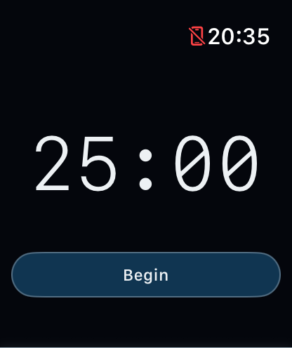
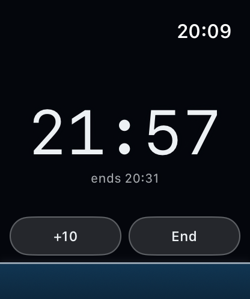
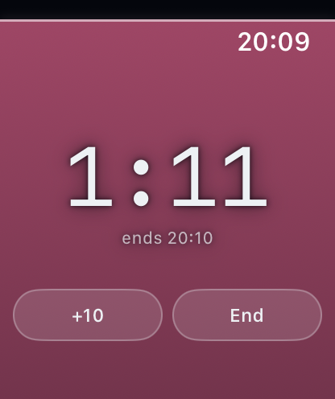
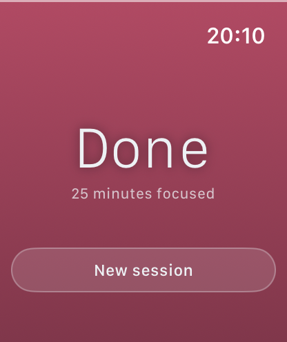

# FocusApp


A standalone Apple Watch focus timer. Pick a duration, one tap to start, countdown on your wrist, haptics at the start, five minutes before the end, and at the end. Extendable mid-session.

No iPhone app. No account. No server. No analytics.

<p align="center">
  
  
  
  
</p>

## The session is a night that ends in dawn

The field rising behind the countdown is the primary readout — the numerals are the precision layer on top of it. It climbs as the session elapses and travels from deep petrol through violet to rose, so *nearly finished* is legible across a room without reading a digit. There is deliberately no separate alarm colour for the last few minutes: by then the dawn has already arrived.

It rises rather than drains because a timer that empties frames focus as something being spent. This one fills as you succeed, and finishing is an arrival rather than a depletion.

Duration is set with the **Digital Crown**, with haptic detents at each stop — the one input unique to this device, and the one most watch apps leave unused. The ladder is fine-grained where it matters and coarse where it doesn't: single minutes up to 10, then five-minute steps to two hours.

---

## This app was supposed to do more

The original idea was: **one tap on the watch silences your phone for the length of a focus session.** That app does not exist here, because after building toward it twice, I established that it can't be done the way I intended. The investigation is the most useful thing in this repository, so it's documented here rather than quietly dropped.

### Attempt 1 — Screen Time APIs

The plan was to shield distracting apps for the session duration using `FamilyControls`, `ManagedSettings` and `DeviceActivity`.

Worth saying why this approach was chosen over the obvious one: **no third-party app can turn on Do Not Disturb.** Apple exposes no API for it, on iOS or watchOS. App shielding is also the better behaviour — Do Not Disturb silences notifications, but it doesn't stop you *opening* Instagram out of habit. A shield does.

The architecture worked out nicely on paper. `DeviceActivity` lets you register a schedule with the system, and a `DeviceActivityMonitor` extension runs in its own process to tear the shield down when the interval ends — so the session would end correctly even if the app were force-quit, the phone rebooted, or the battery died.

It never ran. Attempting to sign the target produces:

> Cannot create a iOS App Development provisioning profile for "com.ismail.focusapp".
> Personal development teams, including "Muhammad Ismail", do not support the Family Controls (Development) capability.

`FamilyControls` is gated behind the paid Apple Developer Program — **not only for App Store distribution, but for local development on your own device.** There is no free path. I had assumed development would be unrestricted and distribution gated; that assumption was wrong, and I'd written a fair amount of code before testing it.

### Attempt 2 — Shortcuts automation

Since an app can't toggle Do Not Disturb directly, the fallback was to have the app trigger a user-created Shortcut that does: *Set Focus → DND On → Wait [duration] → Set Focus → DND Off.*

This works, with one qualification that kills it.

The `Wait` step only survives while the Shortcuts app stays resident in memory. Remove Shortcuts from the app switcher and the timer dies **with Do Not Disturb still on** — silently, indefinitely, with no notification and no recovery. The user's phone is just quiet until they work out why.

And that state is reachable without anyone deliberately force-quitting anything. iOS evicts background apps under memory pressure on its own; a demanding game, video capture, or ordinary memory churn will do it. A reboot or a flat battery does it too.

So Attempt 2 fails in exactly the way Attempt 1's architecture was designed to prevent.

### What both failures have in common

**A timer owned by a process that can be killed is not a timer.**

Attempt 1 handed expiry to the operating system and would have been robust. Attempt 2 kept expiry inside a running app and was not. That distinction is the single thing worth taking from this project, and it's the reason the shipped version is built the way it is.

### What shipped instead

A watch timer that doesn't silence anything. It keeps the promise it can actually keep.

The cost of being wrong here is much lower — a missed haptic is an annoyance, not a phone stuck on mute — but the same principle applies anyway. The countdown you see on screen is driven by an in-app `Timer`, and that timer is **not trusted to tell you the session ended.** The alert that matters is registered with the system via `UNUserNotificationCenter` the moment a session starts, so it fires whether or not this app is still alive. See [`SessionNotifications.swift`](FocusAppWatch/SessionNotifications.swift).

Session end time is also persisted, so a session terminated mid-run is restored on next launch rather than silently lost.

## Running it

```bash
make setup   # installs XcodeGen, generates the project
make run     # builds and launches in the watch simulator
```

No developer account needed — the app uses no entitlements.

### A build gotcha worth knowing

This repo lives under `~/Documents`, which is iCloud-synced. iCloud's file provider stamps `com.apple.FinderInfo` onto files it touches, and `codesign` rejects any bundle carrying it:

> resource fork, Finder information, or similar detritus not allowed

Clearing the attributes doesn't help, because they're reapplied as the build writes files. The fix is to keep the derived data directory outside any synced folder, which the `Makefile` does by default.

## Verification status

Honest accounting of what has and hasn't been tested:

| | Status |
|---|---|
| Builds clean (CI, every push) | ✅ |
| Runs in watchOS Simulator | ✅ |
| Timer, extend, cancel, restore-after-termination | ✅ simulator |
| **Runs on a physical Apple Watch** | ❌ **not yet verified** |
| **Haptic fires with the app backgrounded on real hardware** | ❌ **not yet verified** |

The hardware gap is a tooling problem, not a design one: the test devices run watchOS 27 while the available Xcode supports up to watchOS 26.5, so Xcode cannot deploy to them. Scheduled local notifications firing after app termination is well-established platform behaviour, but *well-established* is not *verified*, and this project has already been wrong about platform assumptions twice. It is listed as unverified until it's confirmed on a wrist.

## Limitations

- **Does not silence your phone.** See above.
- Watch-only. No iPhone app, no complications, no session history.
- Durations run 1–120 minutes: single minutes up to 10, then five-minute steps.

## Licence

MIT — see [LICENSE](LICENSE).
